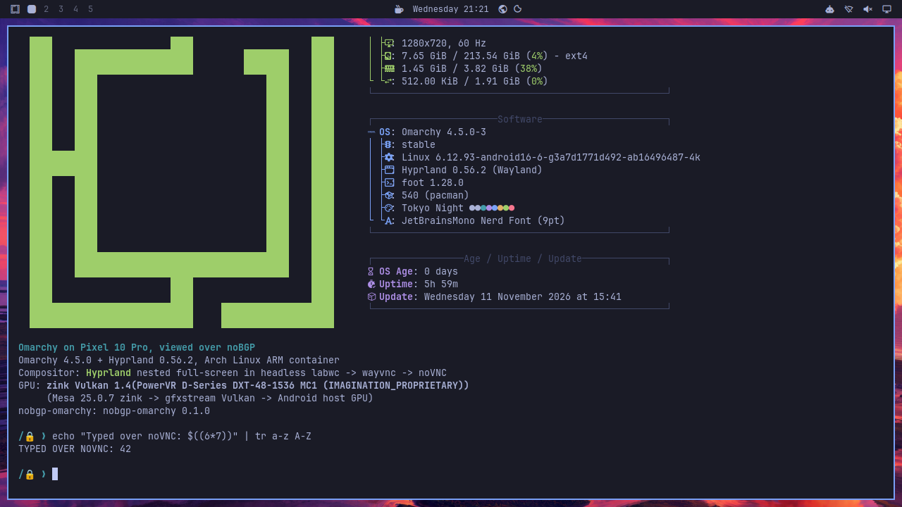
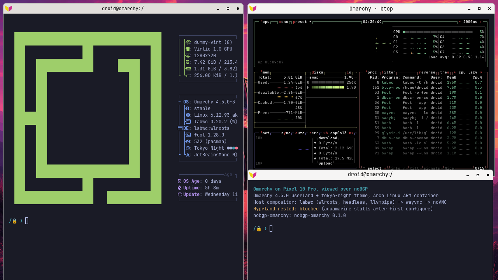
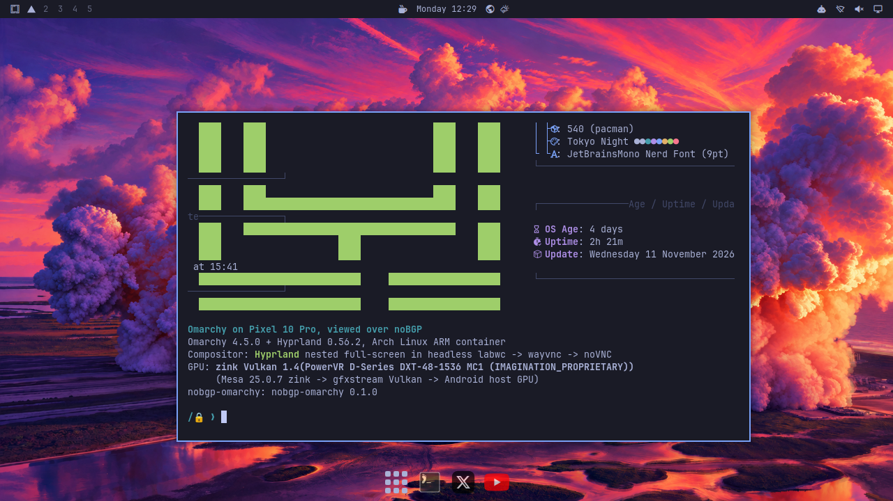
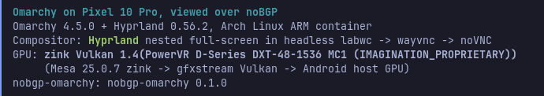

# Omarchy on a Pixel 10 Pro: Arch, Hyprland and the phone's GPU, reachable from anywhere over noBGP

*A build log turned write-up. It was done on a stock Pixel 10 Pro running official Android 17, bootloader locked, using Android's built-in Linux Terminal. Nothing was rooted or flashed, and the phone's own screen session was never touched. The platform facts below were checked on that machine on 16 November 2026.*



## TL;DR

- Android's Linux Terminal app gives you a real Debian 13.7 arm64 VM (8 CPUs, 3.8 GiB RAM, systemd). Inside it, an Arch Linux ARM `systemd-nspawn` container runs **Omarchy 4.5.0 aarch64**, using Omarchy's official aarch64 packages.
- **Hyprland 0.56.2 runs with the full Omarchy shell** (bar, dock, wallpaper, notifications, 24 themes) and is **rendered by the Pixel's PowerVR GPU**: `zink Vulkan 1.4(PowerVR D-Series DXT-48-1536 MC1 (IMAGINATION_PROPRIETARY))`.
- The desktop is off-screen: Hyprland nests inside a headless labwc, which feeds wayvnc, then noVNC. Both listen on **127.0.0.1 only**. That is published as a **sign-in-only noBGP service**, so it opens in any browser, anywhere, with no open ports and no public IP.
- Getting there took 11 stages, several failures, a 26-line `LD_PRELOAD` shim and some honesty about the limits.
- Want to build it yourself? [Reproduce it](#reproduce-it) has every step in order. The stages below explain why each step is there.

## The setup

| | |
|---|---|
| Phone | Stock Pixel 10 Pro (Tensor G5), official Android 17, bootloader locked |
| VM | Debian 13.7 (trixie) arm64, Linux Terminal, kernel 6.12 (android16 GKI), 8 CPUs, 3.8 GiB RAM |
| Phone screen | The Terminal app's own Weston 14 (left alone the whole time) |
| Container | Arch Linux ARM in `systemd-nspawn` at `/var/lib/machines/omarchy` |
| Desktop | Omarchy 4.5.0 aarch64, Hyprland 0.56.2 (Lua config), 24 themes, aquamarine 0.15.1, Quickshell |
| GPU | virtio-gpu capset is gfxstream-vulkan only; zink on PowerVR D-Series DXT-48-1536 MC1 |
| Access | Desktop listens on 127.0.0.1 only, published as a sign-in-only noBGP service |

The phone's Android build is 17. The Terminal VM still boots the image's 6.12 android16 GKI, which is why a fastfetch inside the container prints an `android16` kernel release. That kernel string is the VM, not the phone's Android version.

Screenshots are in [`images/`](images/). The scripts and configs named below are in [`scripts/`](scripts/).

---

## Stage 1: what's inside the phone

```bash
uname -m                 # aarch64
cat /etc/debian_version  # 13.7
cat /etc/os-release      # Debian GNU/Linux 13 (trixie)
nproc; free -h           # 8, 3.8Gi
dmesg | grep -i 'drm.*features'
# [drm] features: +virgl +edid +resource_blob +host_visible +context_init
ps -C weston -o args=    # weston --xwayland --continue-without-input
```

It's a normal systemd Debian VM with passwordless sudo for `droid`. The Terminal app draws its graphical session with **Weston 14**. The kernel even advertises `+virgl`. Remember that, because it turns out to be a red herring.

## Stage 2: Arch Linux ARM as a container

```bash
sudo apt install asciinema systemd-container gnupg arch-install-scripts libarchive-tools
MIRROR=http://fl.us.mirror.archlinuxarm.org/os
curl -fLO $MIRROR/ArchLinuxARM-aarch64-latest.tar.gz
curl -fsSLO $MIRROR/ArchLinuxARM-aarch64-latest.tar.gz.sig
curl -fsSLO $MIRROR/ArchLinuxARM-aarch64-latest.tar.gz.md5
md5sum -c ArchLinuxARM-aarch64-latest.tar.gz.md5
gpg --keyserver hkps://keyserver.ubuntu.com --recv-keys 68B3537F39A313B3E574D06777193F152BDBE6A6   # Arch Linux ARM Build System
gpg --status-fd 1 --verify ArchLinuxARM-aarch64-latest.tar.gz.sig ArchLinuxARM-aarch64-latest.tar.gz | grep VALIDSIG
M=/var/lib/machines/omarchy
sudo mkdir -p $M && sudo bsdtar -xpf ArchLinuxARM-aarch64-latest.tar.gz -C $M
sudo systemd-nspawn -q -D $M --pipe /bin/sh -c 'pacman-key --init && pacman-key --populate archlinuxarm'
sudo systemd-nspawn -q -D $M pacman -Syu
```

**Gotcha:** `os.archlinuxarm.org` served a TLS certificate with a mismatched name. The tarball came over plain HTTP from the official mirror, so it was trusted only after both the checksum and the GPG signature checked out.

## Stage 3: real Omarchy, official aarch64 build

Omarchy is no longer x86-only. Its current branch ships an aarch64 platform with its own package repo and an Omarchy-run Arch Linux ARM mirror. So this is **real Omarchy**, not a lookalike.

```bash
# Omarchy's own pacman.conf + mirrorlist for aarch64 (this build used commit e6554e02 of omacom/omarchy)
OMC=https://raw.githubusercontent.com/omacom/omarchy/master/default/pacman/aarch64
sudo curl -fsSL $OMC/pacman-stable.conf -o $M/etc/pacman.conf
sudo curl -fsSL $OMC/mirrorlist-stable -o $M/etc/pacman.d/mirrorlist
# Omarchy's packaging key, from its own Web Key Directory; check the fingerprint before trusting it
FPR=40DFB630FF42BCFFB047046CF0134EE680CAC571
gpg --auto-key-locate clear,nodefault,wkd --locate-external-keys pkgs@omarchy.org
gpg --fingerprint $FPR
gpg --export $FPR | sudo tee $M/root/omarchy.gpg >/dev/null
sudo systemd-nspawn -q -D $M --pipe pacman-key --add /root/omarchy.gpg
sudo systemd-nspawn -q -D $M --pipe pacman-key --lsign-key $FPR
sudo systemd-nspawn -q -D $M --pipe pacman -Sy --noconfirm omarchy-keyring
```

**Failure:** the first install died with `hyprtoolkit needs libaquamarine.so=15`. Stage 2 had upgraded to Arch Linux ARM *latest*, while Omarchy stable pins an older snapshot. `pacman -Sy` kept the newer databases.

**Fix:** a single flag, the same one Omarchy's own `omarchy-reinstall-pkgs` uses:

```bash
pacman -Syyuu    # force-refresh DBs and allow downgrades to Omarchy's snapshot
pacman -S --needed omarchy omarchy-settings omarchy-nvim base-devel go foot grim slurp wl-clipboard wtype \
  starship fastfetch btop neovim lazygit eza fzf zoxide ripgrep bat fd jq gum tmux less man-db bash-completion \
  noto-fonts noto-fonts-emoji woff2-font-awesome ttf-jetbrains-mono-nerd-basic hyprpicker hyprsunset \
  hyprland-guiutils xdg-desktop-portal-hyprland mesa vulkan-virtio imagemagick inetutils plocate unzip whois \
  mise-bin tldr qt6-imageformats labwc wayvnc swaybg mesa-utils vulkan-tools vulkan-gfxstream
```

The result is Omarchy 4.5.0 with Hyprland 0.56.2, Quickshell, Mesa 26.2.5, 24 themes and the usual tools (neovim, lazygit, btop, fastfetch, starship…). Things a phone container can't use were skipped: Chrome, LibreOffice, Docker, the bootloader and snapshots. Arch ARM's stock `alarm` user was deleted and root was locked. A fresh `droid` user (uid 1000, wheel, password login disabled) took its place:

```bash
systemd-nspawn -q -D $M --pipe bash -c 'userdel -r alarm; passwd -l root; useradd -m -u 1000 -G wheel -s /bin/bash droid; passwd -l droid'
```

## Stage 4: noBGP's Omarchy client, built on the phone

The `nobgp-omarchy` client (bar widget, menu entries, web console launcher) was built **on the phone** inside the container. `make test` passed, then `make pkg` ran makepkg plus its `check()` tests: **26 s on the Tensor G5**. After that, `pacman -U`.

- **Failure:** the install step looked for `*.pkg.tar.zst`, but Arch Linux ARM's makepkg writes `.pkg.tar.xz`. Install whatever `make pkg` wrote (`packaging/archlinux/nobgp-omarchy-*.pkg.tar.*`). `make clean` now removes either kind.
- Inside the container the bar honestly says `stopped`, because the container never got the agent's credentials. That was deliberate.
- On the VM, next to the real agent: `{"class":"connected", "Connected to router.nobgp.com over QUIC", "13 peers"}`.

## Stage 5: Hyprland vs the phone's Weston (blocked)

```
wl_registry: invalid version for global wl_compositor (1): have 5, wanted 6
CBackend::create() failed
```

Weston 14 offers `wl_compositor` v5, but Hyprland 0.56 needs v6. Running Hyprland directly on DRM fails too, because Weston owns the VM's only KMS device:

```
libseat: Couldn't open device at /dev/dri/card0
Cannot open backend: no allocator available
```

Replacing the phone's screen session wasn't an option, so Hyprland had to live somewhere else.

## Stages 6–8: the desktop, off-screen, over noBGP

The idea: render Omarchy into an **invisible** compositor, export it over VNC, and let noBGP publish it privately.

```
omarchy-remote.service   systemd-nspawn (only /dev/dri/renderD128 bound in)
  └─ labwc (headless, 1280x720) ──► wayvnc 127.0.0.1:5900
omarchy-novnc.service    websockify + noVNC on 127.0.0.1:6080
noBGP service            "Omarchy Desktop (noVNC)" → 127.0.0.1:6080, sign-in required
```

```bash
sudo systemd-run --unit=omarchy-remote \
  systemd-nspawn -q -D /var/lib/machines/omarchy \
    --bind=/dev/dri/renderD128 --property='DeviceAllow=/dev/dri/renderD128 rw' \
    --user droid /home/droid/omarchy-remote-session.sh
sudo apt install novnc websockify
sudo systemd-run --unit=omarchy-novnc -p User=droid \
  websockify --web /usr/share/novnc 127.0.0.1:6080 127.0.0.1:5900
```

`omarchy-remote-session.sh` is [`scripts/omarchy-remote-session.sh`](scripts/omarchy-remote-session.sh). Its labwc config is [`scripts/labwc-remote/`](scripts/labwc-remote/). That config's autostart also wants:

- a wallpaper at `~/.local/share/omarchy-remote-bg.png` (any image works);
- `~/.local/bin/btop-nocap`, a plain copy of btop (`cp /usr/bin/btop ~/.local/bin/btop-nocap`). Arch's btop carries file capabilities (`cap_perfmon`) that the container won't grant, and copying drops them;
- [`scripts/omarchy-remote-status.sh`](scripts/omarchy-remote-status.sh), the status pane.

This CPU session is the fallback. The GPU session in stage 11 replaces it.

Both VNC and noVNC listen **only on 127.0.0.1**. The only way in is the noBGP service, which requires a noBGP sign-in. No port forwarding, no public IP and no firewall holes on the phone or the home network.

**How the compositor was chosen:**

| Compositor | Result |
|---|---|
| sway 1.12 headless | works, but `invalid version for global xdg_wm_base: expected at most 5, got 6` for Hyprland |
| Weston 15 headless | wl_compositor v5, ruled out |
| **labwc 0.20.2** | wl_compositor v6, xdg_wm_base v6, dmabuf, screencopy, virtual input ✔ |

**The catch:** the container's Mesa printed `No virgl contexts available on host`, so everything rendered on **llvmpipe** (the CPU). Hyprland nested in labwc connected and got configured, then sat at a black window while spinning on `epoll_pwait` at 90% CPU. So stage 8 shipped a fallback: Omarchy's apps (fastfetch, btop, a status pane) running directly in labwc, labeled on screen as "Hyprland nested: blocked".



---

## The GPU story (stages 9–11)

### Stage 9: ask the GPU what it actually speaks

`+virgl` in dmesg suggested virgl should work. The real answer comes from asking virtio-gpu which **context types** (capsets) the host supports:

```bash
sudo grep -E 'virgl|context init|cap sets' /sys/kernel/debug/dri/128/virtio-gpu-features
#   virgl : yes   context init : yes   cap sets : 1
sudo python3 capsets.py      # DRM_IOCTL_VIRTGPU_GETPARAM(VIRTGPU_PARAM_SUPPORTED_CAPSET_IDs)
#   VIRTGPU_PARAM_SUPPORTED_CAPSET_IDs = 0x8 -> ['gfxstream-vulkan']
```

The probe is [`scripts/capsets.py`](scripts/capsets.py). Checked again on 16 November 2026, the mask is still `0x8`: **one capset, gfxstream-vulkan.** No virgl, no venus, no DRM-native context. That is why virgl failed: the feature bit exists, but the host never offers a virgl context.

The phone's own Weston showed the way. Its environment is:

```
MESA_LOADER_DRIVER_OVERRIDE=zink
VK_DRIVER_FILES=/usr/share/vulkan/icd.d/gfxstream_vk_icd.json
MESA_VK_WSI_DEBUG=sw
```

That means OpenGL is done by **zink** (GL on top of Vulkan), and Vulkan is **gfxstream**, which forwards to the host's PowerVR driver. Arch has the same driver as `vulkan-gfxstream`, and `vulkaninfo` in the container sees the GPU:

```
deviceName = Virtio-GPU GFXStream (PowerVR D-Series DXT-48-1536 MC1)
driverInfo = Mesa 26.2.5-arch1.1
```

### Stage 10: Arch Mesa says no, Debian Mesa says yes

Arch's zink refuses the device:

```
MESA: error: Zink requires the nullDescriptor feature of KHR/EXT robustness2.
OpenGL core profile renderer: llvmpipe (LLVM 23.1.3, 128 bits)
```

The **same GPU** from the Debian VM side with Debian's Mesa 25.0.7:

```
OpenGL core profile renderer: zink Vulkan 1.4(PowerVR D-Series DXT-48-1536 MC1 (IMAGINATION_PROPRIETARY))
```

Newer zink requires `nullDescriptor` from robustness2; this gfxstream/PowerVR stack doesn't offer it, and the older zink in Debian doesn't need it. The fix is self-contained and needs no changes to Arch's packages. Copy Debian's Mesa stack (182 MB) into the container under `/opt/debian-mesa` and point the loaders at it. [`scripts/copy-debian-mesa.sh`](scripts/copy-debian-mesa.sh) does the copy, run as root in the Debian VM. It takes Mesa's EGL, GBM, gallium (zink) and gfxstream Vulkan libraries plus LLVM 19 and the few libraries they need, all already in the Terminal's Debian image. Then it installs [`scripts/debian-mesa/env.sh`](scripts/debian-mesa/env.sh):

```bash
# /opt/debian-mesa/env.sh (source inside the container)
export LD_LIBRARY_PATH=/opt/debian-mesa/lib
export LIBGL_DRIVERS_PATH=/opt/debian-mesa/lib/dri GBM_BACKENDS_PATH=/opt/debian-mesa/lib/gbm
export VK_DRIVER_FILES=/opt/debian-mesa/icd.d/gfxstream_vk_icd.json
export MESA_LOADER_DRIVER_OVERRIDE=zink MESA_VK_WSI_DEBUG=sw
export NODEVICE_SELECT=1 VK_LOADER_LAYERS_DISABLE='*device_select*'   # stage 11, fix 1
```

```
OpenGL ES profile renderer: zink Vulkan 1.4(PowerVR D-Series DXT-48-1536 MC1 (IMAGINATION_PROPRIETARY))
OpenGL ES profile version: OpenGL ES 3.2 Mesa 25.0.7-2+deb13u1
```

The same renderer string still comes back from `eglinfo` inside the container. labwc (`WLR_RENDERER=gles2` on `renderD128`) picked it up right away. llvmpipe was gone.

### Stage 11: three fixes, then Hyprland lights up

With a real GPU, nested Hyprland still failed. gdb and strace found three separate bugs.

**Fix 1: the device_select deadlock.** Arch's Vulkan layer `VK_LAYER_MESA_device_select` opens a Wayland connection to `$WAYLAND_DISPLAY` while it enumerates GPUs. Inside Hyprland, that variable points at *Hyprland's own socket*, which isn't serving yet. So `gbm_create_device → vkEnumeratePhysicalDevices` waits on itself forever.

```bash
export NODEVICE_SELECT=1 VK_LOADER_LAYERS_DISABLE='*device_select*'
```

**Fix 2: the flush that never happens (`aqflush.so`).** This was the real cause of stage 8's black window. aquamarine's Wayland backend queues its first requests to the parent compositor and never flushes them until some event arrives. When the buffer finally lands, it beats the configure handshake, and labwc disconnects it:

```
xdg_surface#3: error 3: xdg_surface has never been configured
```

After that, Hyprland spins on `EPOLLIN|EPOLLHUP`. The workaround is a 26-line `LD_PRELOAD` shim. It remembers every `wl_display` the process connects to and calls `wl_display_flush()` before each `epoll_wait`/`epoll_pwait`:

```c
// aqflush.c (abridged): build with gcc -O2 -fPIC -shared aqflush.c -o aqflush.so -ldl
struct wl_display *wl_display_connect(const char *name) {
    struct wl_display *d = real_connect(name); remember(d); return d;
}
int epoll_wait(int fd, struct epoll_event *ev, int n, int t) {
    flush_all();                       // wl_display_flush() on every remembered display
    return real_epoll_wait(fd, ev, n, t);
}
__attribute__((constructor)) static void init(void) { unsetenv("LD_PRELOAD"); } // don't leak into children
```

Full source, 26 lines: [`scripts/aqflush/aqflush.c`](scripts/aqflush/aqflush.c). Build it inside the container (base-devel is installed) into `/opt/aqflush/aqflush.so`. This should be fixed upstream in aquamarine.

**Fix 3: no preferred mode.** The nested output arrives without a mode:

```
ERR from aquamarine ]: Output WAYLAND-1: pending state rejected: invalid mode
Monitor WAYLAND-1 has NO PREFERRED MODE
```

That leaves the monitor at 0x0. Setting it at runtime with `hyprctl` doesn't help, but setting it at startup does:

```lua
-- ~/.config/hypr/remote.lua
dofile(os.getenv("HOME") .. "/.config/hypr/hyprland.lua")   -- the normal Omarchy config
hl.monitor({ output = "WAYLAND-1", mode = "1280x720@60", position = "0x0", scale = 1 })
hl.config({ input = { repeat_delay = 600, repeat_rate = 25 } })  -- VNC latency caused doubled keys
```

The full file is [`scripts/remote.lua`](scripts/remote.lua). The headless labwc config under the GPU session is [`scripts/labwc-remote-gpu/`](scripts/labwc-remote-gpu/).

**Container housekeeping for the Omarchy shell:**

- The container has no journald, so `systemd-cat` failed and Quickshell never started. A PATH shim that just runs the command fixes it: [`scripts/remote-bin/systemd-cat`](scripts/remote-bin/systemd-cat).
- Omarchy's first-run provisioning busy-looped on its Wi-Fi step (there's no NetworkManager in the container). A shim skips it: [`scripts/remote-bin/omarchy-provision-first-run`](scripts/remote-bin/omarchy-provision-first-run). Both shims live in `~/.local/share/omarchy-remote/bin`, which comes first on Hyprland's `PATH`.
- `qt6-imageformats` was needed for the webp wallpaper.
- The idle lock was turned off with Omarchy's stay-awake indicator.
- First-run was marked done (`omarchy-done mark first-run-user`) so it stopped re-posting setup notifications on every start.

Two scripts tie it together. [`scripts/omarchy-remote-session-gpu.sh`](scripts/omarchy-remote-session-gpu.sh) starts the headless labwc on the GPU. Its autostart ([`scripts/labwc-remote-gpu/`](scripts/labwc-remote-gpu/)) starts wayvnc and [`scripts/omarchy-hypr-nested.sh`](scripts/omarchy-hypr-nested.sh), which starts Hyprland with the Debian Mesa environment, the shims on `PATH` and `aqflush.so` preloaded.

The final session chain:

```
omarchy-remote.service
 └ systemd-nspawn (renderD128 only)
    └ labwc, headless, GLES2 on zink → gfxstream → PowerVR
       ├ wayvnc 127.0.0.1:5900 ─► noVNC 127.0.0.1:6080 ─► noBGP service (sign-in only)
       └ Hyprland 0.56.2 nested full-screen (Omarchy config + remote.lua, LD_PRELOAD=aqflush.so)
          └ Quickshell bar/dock/notifications, foot, ...
```

`hyprctl` confirms the monitor at `WAYLAND-1 1280x720@60`, layers `omarchy-background`, `omarchy-bar`, `omarchy-dock` and `omarchy-notifications`, and a live client.





---

## Reproduce it

Everything above, in order, using the files in [`scripts/`](scripts/). Run the commands from `docs/pixel-10-pro` in a clone of this repo. Steps 1–3 run in the Terminal's Debian VM as `droid`, which has passwordless sudo. `M=/var/lib/machines/omarchy`, and `C="sudo systemd-nspawn -q -D $M --pipe"` runs a command in the container. Do steps 1–3 while the desktop is stopped, because `systemd-nspawn` refuses a container tree that's already running.

1. **The container and Omarchy.** Follow stages 2 and 3: the Arch Linux ARM tarball (checksum and signature checked), Omarchy's aarch64 repo and key, `pacman -Syyuu`, the package list, then the `droid` user.
2. **The GPU stack.** Copy Debian's Mesa in, then build the flush shim inside the container:
   ```bash
   sudo ./scripts/copy-debian-mesa.sh
   sudo install -D -m 644 scripts/aqflush/aqflush.c $M/opt/aqflush/aqflush.c
   $C gcc -O2 -fPIC -shared /opt/aqflush/aqflush.c -o /opt/aqflush/aqflush.so -ldl
   ```
3. **The session files**, owned by uid 1000 in the container:
   ```bash
   H=$M/home/droid
   sudo install -o 1000 -g 1000 -m 755 scripts/omarchy-remote-session-gpu.sh scripts/omarchy-hypr-nested.sh scripts/omarchy-remote-status.sh $H/
   sudo install -d -o 1000 -g 1000 $H/.config/labwc-remote-gpu $H/.config/hypr $H/.local/share/omarchy-remote/bin
   sudo install -o 1000 -g 1000 -m 644 scripts/labwc-remote-gpu/* $H/.config/labwc-remote-gpu/
   sudo install -o 1000 -g 1000 -m 644 scripts/remote.lua $H/.config/hypr/remote.lua
   sudo install -o 1000 -g 1000 -m 755 scripts/remote-bin/* $H/.local/share/omarchy-remote/bin/
   $C su droid -c 'omarchy-done mark first-run-user'
   ```
   `remote.lua` loads `~/.config/hypr/hyprland.lua`, so Omarchy's own user config must be in place first. If it isn't, run Omarchy's user setup once as `droid`.
4. **Start the desktop and noVNC.** Both listen on 127.0.0.1 only:
   ```bash
   sudo systemd-run --unit=omarchy-remote --description='Omarchy off-screen desktop' \
     systemd-nspawn -q -D $M --bind=/dev/dri/renderD128 --property='DeviceAllow=/dev/dri/renderD128 rw' \
       --user droid /home/droid/omarchy-remote-session-gpu.sh
   sudo apt install -y novnc websockify
   sudo systemd-run --unit=omarchy-novnc -p User=droid \
     websockify --web /usr/share/novnc 127.0.0.1:6080 127.0.0.1:5900
   ```
   Logs go to `$M/home/droid/shots/`. These are transient units, so run step 4 again after the VM restarts.
5. **Make it reachable with noBGP.** Install the agent in the Debian VM (not the container) and join your network. `NOBGP_KEY` is a network key from the noBGP console:
   ```bash
   curl -fsSL https://downloads.nobgp.com/agent/install.sh -o /tmp/nobgp-install.sh
   sudo NOBGP_KEY=<your network key> sh /tmp/nobgp-install.sh
   ```
   Then publish `http://127.0.0.1:6080` as a service, from the web console or with `nobgp login` then `nobgp proxy publish`. Leave it private (sign-in required) and share it only with yourself or people you choose. Open its URL from any computer, then click Connect. The status pane's GPU line should name the PowerVR GPU, not llvmpipe. Anyone the service is shared with gets the whole desktop, so keep the share list short.

## Honest limits

- **labwc is underneath.** Hyprland isn't the top-level compositor. It's a full-screen Wayland client of a headless labwc, because nothing else on this VM gives it a backend and an allocator. A headless-only Hyprland fails with `Cannot open backend: no allocator available`, and the kernel has no vkms.
- **Frames are copied back on the CPU.** `MESA_VK_WSI_DEBUG=sw` means the GPU renders but presentation reads the frames back through software WSI. That's the same trick the phone's own Weston uses.
  - A full-screen terminal redrawing nonstop costs Hyprland about 76% of one core.
  - `vkgears` runs at **1.27 FPS**.
  - `es2gears_wayland` and `eglgears_wayland` crash on both Mesa stacks.
- **It's a desktop, not a gaming rig.** At idle the session is about 0% CPU, the VM is about 79% idle on 8 cores, and it uses about 1.5–1.7 GB of 3.8 GiB RAM.
- **It's VNC.** 1280x720 over noVNC. From a laptop browser, with the phone on 5G and Wi-Fi off, round trips measured a median of 140 ms (mostly 125–150 ms, with occasional spikes to about 430 ms). Typing and clicking are fine, but it's not 120 Hz.
- **It's not on the phone's screen.** The Terminal app's Weston (wl_compositor v5) still can't host Hyprland. Viewing happens in a browser, which can be a browser on the phone itself.

## Everything is reversible

- **Back to the CPU-rendered labwc session:** stop the unit, then `systemd-run` it again with the old `omarchy-remote-session.sh`.
- **Remove the GPU path:** delete `/opt/debian-mesa`, `/opt/aqflush`, `~/.config/labwc-remote-gpu`, `~/.config/hypr/remote.lua` and `~/.local/share/omarchy-remote` inside the container.
- **Remove everything:**
  1. Stop `omarchy-remote` and `omarchy-novnc`.
  2. Unpublish the noBGP service.
  3. `rm -rf /var/lib/machines/omarchy`.

Nothing on Android, the phone's own screen session or the phone's noBGP app node was changed.

## Why noBGP

The phone sits behind carrier or home NAT. The VM's address is a private guest IP, and the desktop listens only on `127.0.0.1`. noBGP's agent in the VM publishes that loopback port as a service that **requires sign-in**, so the desktop opens from a laptop or another computer as a normal HTTPS page. Nothing is exposed to the internet. The same agent also gave remote shell, file copy and service health checks for the whole build.

## Files

- [`images/`](images/): the screenshots above
- [`scripts/capsets.py`](scripts/capsets.py): virtio-gpu capset probe
- [`scripts/aqflush/aqflush.c`](scripts/aqflush/aqflush.c): the 26-line flush shim
- [`scripts/copy-debian-mesa.sh`](scripts/copy-debian-mesa.sh) and [`scripts/debian-mesa/env.sh`](scripts/debian-mesa/env.sh): the Debian Mesa copy and its environment
- [`scripts/omarchy-remote-session-gpu.sh`](scripts/omarchy-remote-session-gpu.sh): GPU session entry (headless labwc)
- [`scripts/omarchy-hypr-nested.sh`](scripts/omarchy-hypr-nested.sh): starts the nested Hyprland
- [`scripts/omarchy-remote-status.sh`](scripts/omarchy-remote-status.sh): the on-screen status pane
- [`scripts/remote-bin/`](scripts/remote-bin/): the `systemd-cat` and first-run shims
- [`scripts/remote.lua`](scripts/remote.lua): nested Hyprland config
- [`scripts/omarchy-remote-session.sh`](scripts/omarchy-remote-session.sh): CPU-rendered labwc session
- [`scripts/labwc-remote/`](scripts/labwc-remote/): labwc config for that CPU session
- [`scripts/labwc-remote-gpu/`](scripts/labwc-remote-gpu/): headless labwc config under the GPU session
